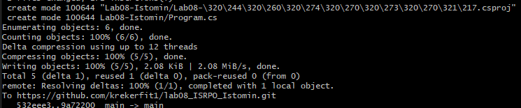
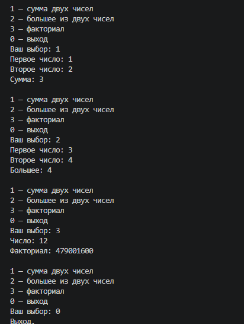

# Практическая работа №8

**ФИО:** Истомин Максим Алексеевич

**Группа:** ИСП -243

**Дата:** 24.10.26

## Что изучено

- результат работы метода через оператор return
- работа с параметрами и возвращаемыми значениями
- использование методов для работы с массивами и циклами

## Скриншоты

